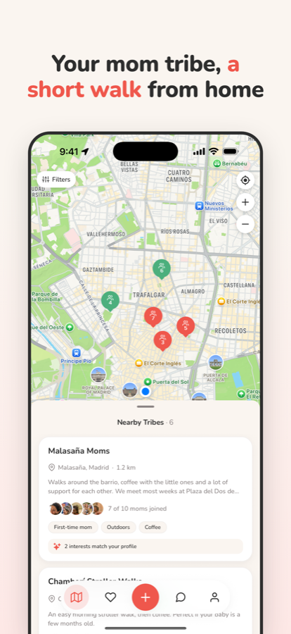
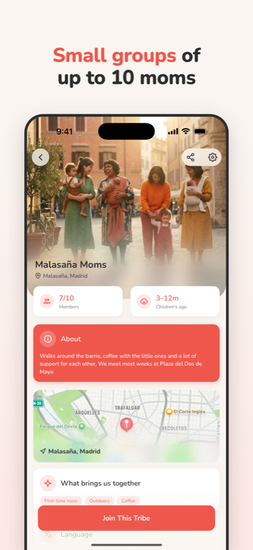
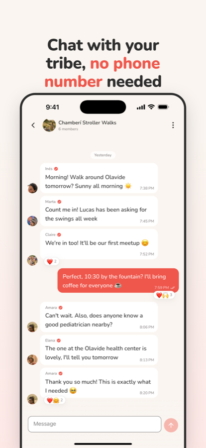
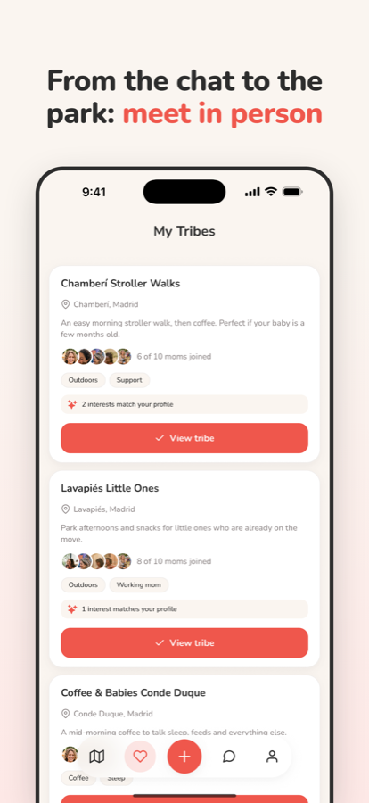
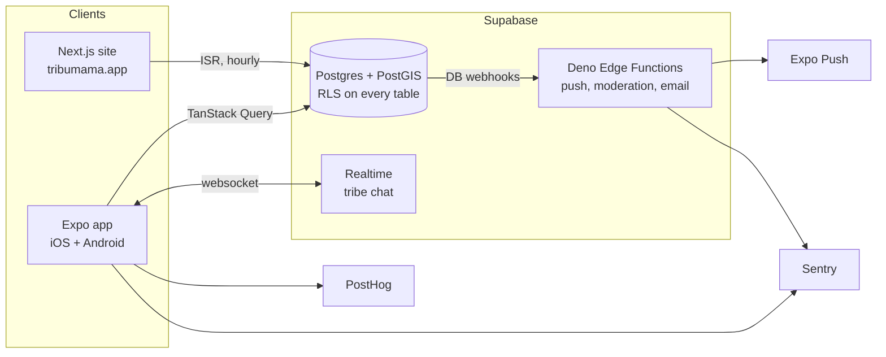
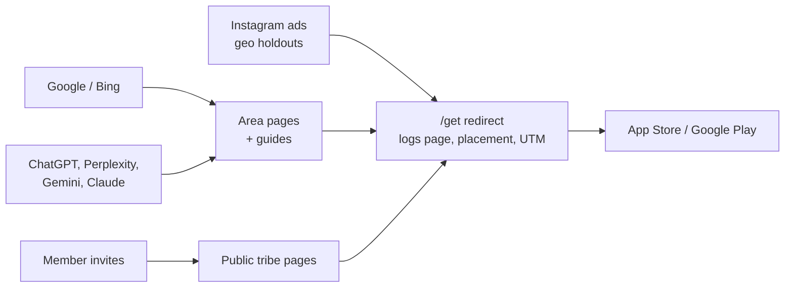
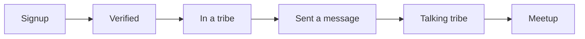
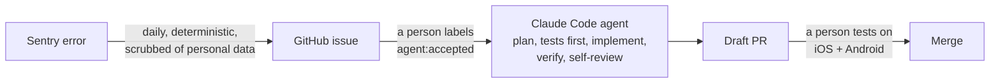

# TribuMama: engineering and growth case study

TribuMama helps mothers in the same neighbourhood meet in small, verified local
groups ("tribes") of about 10. It's live on the App Store, Google Play and
[tribumama.app](https://tribumama.app), in four languages.

I built it on my own, covering product, design, engineering, infrastructure,
store releases and growth. The product repository is private because it holds a
production database schema and data about real mothers. This repo is a curated
look inside: how the system is built, how growth is measured and driven, and
some of the real code.

<p>
  
  
  
  
</p>

## At a glance

| | |
|---|---|
| **Role** | Solo founder and engineer, since June 2026 |
| **Traction** | 1,000+ mothers and 100+ active tribes |
| **Surfaces** | iOS and Android app (Expo, React Native), Next.js marketing site, Supabase backend |
| **Languages** | Spanish, English, French and German |
| **How I work** | Hypothesis, build, instrument, measure, decide. With AI agents doing a real share of the engineering |

## Architecture



- **TypeScript monorepo** (npm workspaces + Turborepo) with Zod schemas shared
  across the app, the website and the database.
- **Hyperlocal discovery** with PostGIS: GiST-indexed geography columns and
  viewport-based RPCs. Location is coarse by design, so no mother's home
  location is ever exposed.
- **CI/CD** on GitHub Actions: typecheck, lint and tests on every PR, migration
  ordering checks, table-grant checks, then automatic deploys of migrations,
  edge functions and the website on merge. Mobile ships through EAS Build and
  EAS Update.

## Growth

### Acquisition



- **Programmatic SEO.** Neighbourhood landing pages are generated from live
  database data with incremental static regeneration. A page stays `noindex`
  until its area clears a privacy floor of real members, so thin pages never
  reach the index and small groups are never exposed. See
  [`web-growth/area-page.tsx`](web-growth/area-page.tsx).
- **Search and AI assistants.** Organization, MobileApplication, FAQPage,
  Article and BreadcrumbList JSON-LD all come from one source of site facts.
  The site also has localized sitemaps with hreflang, and pings IndexNow
  after every deploy. Visits from AI assistants are tracked as their own
  referral event.
- **Attribution.** Every install link goes through `/get`, which records the
  page and placement and forwards the campaign to App Store campaign analytics.
- **Paid.** I ran Instagram install campaigns, then measured them by geography
  against holdout areas in SQL, because consent gating meant the ad platform
  under-reported installs.
- **Store listing (ASO).** The listings were repositioned around the
  neighbourhood angle. Store screenshots are generated from scripted app
  scenarios, so they're refreshed whenever the UI changes.

### Activation, measured



The North Star metric is **talking tribes per week**: tribes where at least two
different mothers wrote that week. Each step of the funnel has a 7-day cohort
KPI. The canonical definitions live in SQL functions, so the weekly report, the
dashboards and the KPI agent all get the same numbers. The cohorts are small
(40 to 60 a week), so week-on-week changes under about 20 points are treated
as noise and trends are read on rolling 4-week cohorts.

**One loop, end to end.** Data showed that 70% of new members were joining
groups that had gone quiet. I traced part of it to a join notification that
never fired in production, fixed it on the server, and changed how groups are
suggested so active ones rank first. Then I re-measured on the next cohorts.

### Shipping safely and fast

- Server-side **feature flags**. A feature merges dark and goes live later in a
  separate activation release.
- **Over-the-air updates** for JavaScript-only fixes, plus a remote **version
  gate** that moves old clients forward before a breaking backend change.
- A **regression suite** for the chat, with device-measured performance guards.

## AI-first engineering

Production errors turn into fixes with a person deciding at every step that
matters:



The code is in [`agent-workflows/`](agent-workflows/):

| File | What it shows |
|---|---|
| [`sentry-triage.mjs`](agent-workflows/sentry-triage.mjs) + [tests](agent-workflows/sentry-triage.test.mjs) | Files each new Sentry error as a GitHub issue, once. Dedupe lives in a hidden marker in the issue body, so reruns are harmless. Reopens on regression. Scrubs ids, emails, phone numbers and query strings before anything reaches GitHub, and escapes HTML so the person who labels the issue sees exactly what the agent will read. No model runs here, so a quiet day costs nothing. |
| [`sentry-triage.yml`](agent-workflows/sentry-triage.yml) | Daily schedule, dry-run mode, least-privilege token. |
| [`claude-implement.yml`](agent-workflows/claude-implement.yml) | Labelling an issue starts Claude Code headless. The private repo's `main` can't be branch-protected on this GitHub plan, so the workflow itself has to keep the agent away from production. The agent works with a read-only token, and every command it runs goes through a sandbox with no network and no credentials in its environment. Its commits leave the job as a bundle. A second job, which runs no agent code, checks the branch name and the paths it touches, scans every commit and text for credentials (gitleaks), then pushes and opens the draft PR. |
| [`implement-issue.SKILL.md`](agent-workflows/implement-issue.SKILL.md) | The agent's playbook: understand, plan, test first, implement, verify with fresh command output, run an independent review, then open a draft PR with acceptance criteria checked off and a device test plan. |

A weekly agent also reads the KPIs, walks the funnel step that leaks most, and
proposes experiments, each tied to the KPI it should move.

Run the triage tests (Node 20+, no dependencies):

```bash
node --test agent-workflows/sentry-triage.test.mjs
```

## Privacy as a design constraint

TribuMama holds sensitive data: mothers' identities, photos, children's ages
and neighbourhood-level location. Row Level Security is the security boundary
on every table. Location is coarse by design. Analytics follow a written list of
what must never be sent, and every mother is selfie-verified before she can join a tribe. The code in
this repo follows the same rules: nothing in it comes from a real user.

## Contact

Marta Atienza Gallego ·
[LinkedIn](https://linkedin.com/in/martattack) ·
[tribumama.app](https://tribumama.app)
